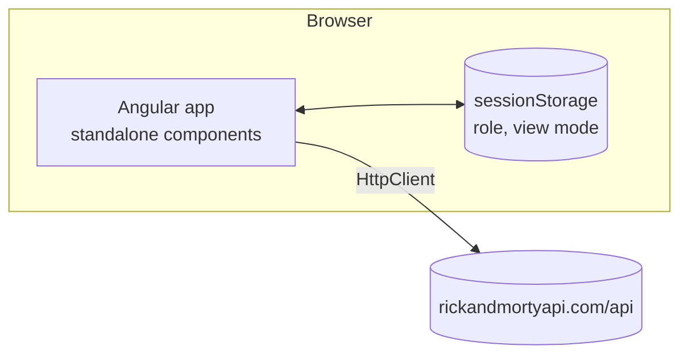
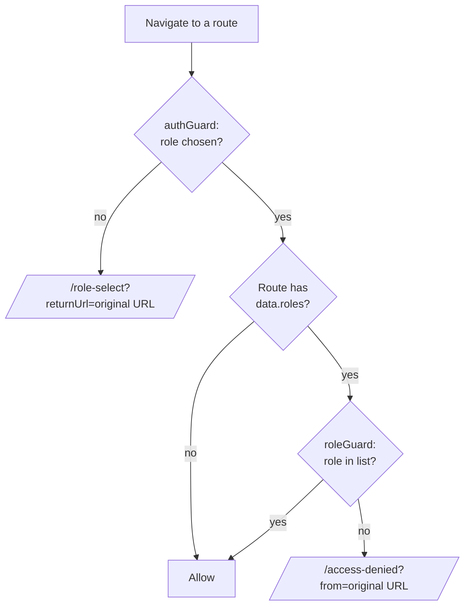
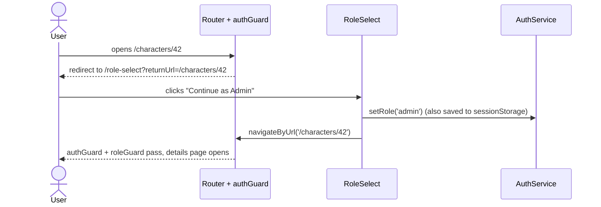
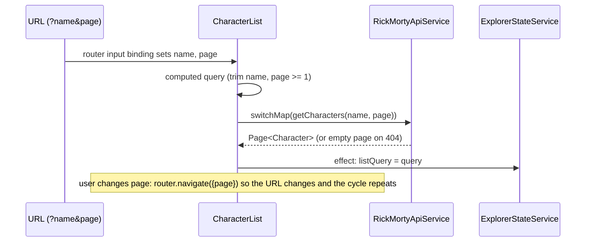
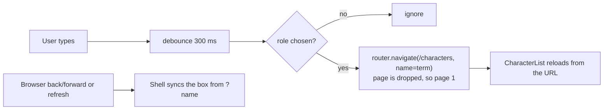
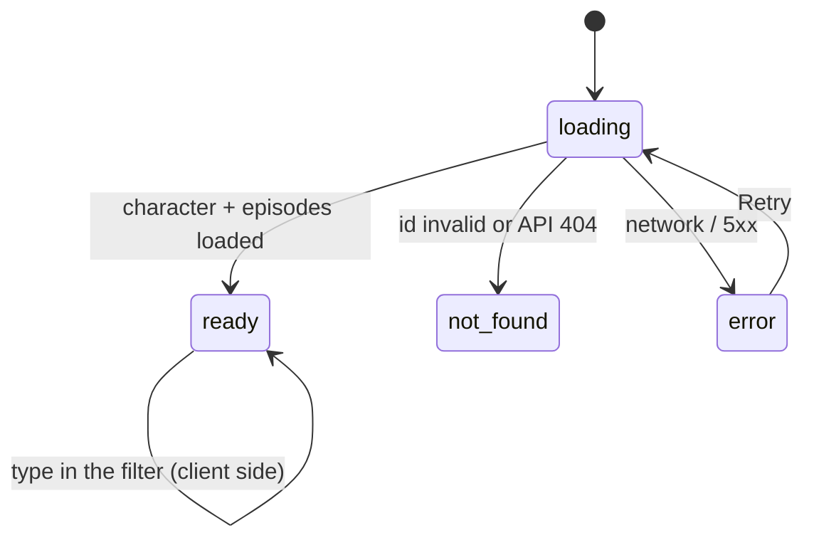

# Architecture & design

## 1. Overview

A single-page Angular application with no backend of its own. The browser talks directly to the public
Rick and Morty API. "Authentication" is simulated entirely in the browser: the user picks a role, and route
guards decide what that role may open.



## 2. Layers and folders

```
src/app/
  app.ts | app.html | app.scss   Shell: toolbar, global search box, role badge, <router-outlet>
  app.config.ts                  Providers: router (with input binding), HttpClient (fetch)
  app.routes.ts                  Route table and guards

  core/                          Framework-agnostic building blocks, no UI
    models/                      Types for API data and the domain (Character, Episode, Page, Role, ViewMode)
    services/
      auth.service.ts            Current role (signal) + sessionStorage persistence
      explorer-state.service.ts  View mode, last list query, last opened character
      rick-morty-api.service.ts  The only code that calls the API
    guards/
      auth.guard.ts              "Is a role chosen?"
      role.guard.ts              "Is this role allowed on this route?"
    storage.ts                   Safe sessionStorage helpers

  features/                      One folder per screen
    role-select/                 Pick Admin or Viewer
    access-denied/               Shown when a guard rejects a role
    characters/
      character-list/            Home page: grid/list, pagination, empty/error states
      character-card/            Presentational card used by the list
      character-details/         Profile + episodes table + client-side filter

  testing/fixtures.ts            Test-only data builders (not used by app code)
```

Dependency rule: `features/*` may use `core/*`; `core/*` never imports from `features/*`.

## 3. Routing and authorization

| Path | Guards | Component | Notes |
| --- | --- | --- | --- |
| `/` | n/a | n/a | Redirects to `/characters` |
| `/role-select` | none | `RoleSelect` | Always reachable, also used to switch role |
| `/characters` | `authGuard` | `CharacterList` | Query params: `name`, `page` |
| `/characters/:id` | `authGuard`, `roleGuard` | `CharacterDetails` | `data: { roles: ['admin'] }` |
| `/access-denied` | `authGuard` | `AccessDenied` | Query param: `from` (the blocked route) |
| `**` | n/a | n/a | Redirects to `/characters` |

### Role model

| Capability | Admin | Viewer |
| --- | --- | --- |
| Open `/characters` (list, search, pagination, list/grid) | Yes | Yes |
| Open `/characters/:id` (details and episodes) | Yes | No, redirected to `/access-denied` |

The route's allowed roles live in the route table (`data.roles`), not inside the guard, so adding a role or
protecting another route is a configuration change.

### Guard flow



### Deep link with no role chosen



`RoleSelect` only follows a `returnUrl` that is an internal absolute path. Values such as `//evil.example`,
`https://...`, `javascript:...` or the role-select page itself are ignored and the user goes to `/characters`.

## 4. State management

No global store. State is split by lifetime and by who needs it:

| State | Where it lives | Survives | Why there |
| --- | --- | --- | --- |
| Search term (`name`) | URL query param | refresh, back/forward, shared link | Makes the page bookmarkable and history-friendly |
| Page number (`page`) | URL query param | refresh, back/forward, shared link | Same |
| Current role | `AuthService` signal + `sessionStorage` (`character-explorer.role`) | refresh, not tab close | Simulated login |
| List/grid choice | `ExplorerStateService` signal + `sessionStorage` (`character-explorer.view-mode`) | refresh, not tab close | A per-user preference |
| Last list query (`name`, `page`) | `ExplorerStateService` signal (memory) | navigation within the app | Lets "Back to characters" restore the list |
| Last opened character id | `ExplorerStateService` signal (memory) | navigation within the app | Highlights the card when returning to the list |

`sessionStorage` access goes through `core/storage.ts`, which swallows exceptions (private mode, blocked
storage), so the app still works with in-memory state only.

## 5. Data flow

### API usage

| Use case | Request | Called from |
| --- | --- | --- |
| List, search, paginate | `GET /character?page={n}&name={text}` | `RickMortyApiService.getCharacters` |
| Character for the details page | `GET /character/{id}` | `getCharacter` |
| Episodes of a character | `GET /episode/{id1,id2,...}` (one request) | `getEpisodes` |
| Details page (both of the above) | character, then its episodes | `getCharacterWithEpisodes` |

Behaviours handled in `RickMortyApiService` so components stay simple:

| API behaviour | Handling |
| --- | --- |
| No match for a name (or page out of range) answers **HTTP 404** `{"error":"There is nothing here"}` | Converted into an empty page: the UI shows "No characters found", not an error |
| `/episode/1` returns an **object**, `/episode/1,2` returns an **array** | Always normalized to an array |
| A character has no episodes | No request is made; empty array |
| Total episodes per character | Computed as `character.episode.length`; no extra requests |
| Episode ids | Parsed from the character's `episode` URLs (`.../episode/12` becomes `12`) |

### List screen



`switchMap` cancels an in-flight request when the query changes, so a slow earlier response can never
overwrite a newer one.

### Global search

The search box lives in the app shell (the toolbar), so it works on every screen.



The URL is the source of truth: the box writes to the URL, and the URL writes back to the box
(without re-triggering a search).

### Details screen

`CharacterDetails` receives `:id` as an input, loads the character and its episodes, and exposes one of four
states.



The episodes table is filtered **client-side** by episode **name only** (case-insensitive "contains"), via the
pure function `filterEpisodesByName`. It does not match `air_date` or the episode code and never calls the API.

## 6. UI composition

| Component | Responsibility | Inputs |
| --- | --- | --- |
| `App` | Toolbar, global search, role badge, "Switch role" | none |
| `RoleSelect` | Role cards, safe redirect after choosing | `returnUrl` (query param) |
| `AccessDenied` | Explains what was blocked, links back | `from` (query param) |
| `CharacterList` | Loads and shows a page of characters, paginator, grid/list toggle | `name`, `page` (query params) |
| `CharacterCard` | Presentational: avatar, status, facts; link or locked | `character`, `layout`, `clickable`, `selected` |
| `CharacterDetails` | Profile, episodes table, filter | `id` (route param) |

Notable UI behaviours:

- **Viewer** cards are rendered locked (not links) with a tooltip, plus a banner; typing a details URL
  lands on the Access Denied page instead.
- **Error states** use `role="alert"` and have a Retry button where retrying makes sense.
- **Pagination** is 1-based in the URL and API, 0-based in `mat-paginator`; the page size is fixed at 20
  (the API's page size), so the size selector is hidden.
- **Accessibility:** avatars have alt text, controls have labels, the search clear button is a real button.

## 7. Cross-cutting concerns

| Concern | Approach |
| --- | --- |
| Error handling | API errors are mapped to component states; no global interceptor (see "Future work") |
| Loading | Spinner while a request is in flight |
| Change detection | Zone.js with event coalescing; components read signals |
| Subscriptions | `toSignal` / `takeUntilDestroyed`, so no manual unsubscribe |
| Security | Guards run in the browser only; they are a UX demo, not a security boundary |
| Offline | Needs internet: the API, Google Fonts and Material Icons are loaded from CDNs |
| Bundle size | About 730 kB initial (about 162 kB transferred); budget raised to 900 kB warn / 1.5 MB error because of Angular Material |

## 8. Design decisions

| Decision | Reason | Alternative considered |
| --- | --- | --- |
| Signals + services instead of NgRx | The state is small and mostly URL-driven; less boilerplate | NgRx |
| Page and search in the URL | Refresh, back/forward and links just work | Keeping them in a service |
| Server-side search, client-side episode filter | The brief asks for exactly this; the API supports `?name=` | Fetch all 42 pages and filter locally |
| Pagination | Matches the paged API and server-side search | Infinite scroll, load everything |
| Locked cards for Viewer, plus a guard | Clear in the list, and still safe if the URL is typed | Let Viewers click and land on Access Denied |
| Role in `sessionStorage` | Survives refresh, ends with the tab | `localStorage` (would persist across sessions) |
| Details route fetches by id | Works on refresh and deep links | Passing the character through router state |
| Angular Material | Ready-made table, paginator, toolbar, toggles | Plain SCSS, Tailwind |

## 9. Known limitations and future work

- Guards are client-side only; a real application needs server-side authorization.
- The initial bundle could shrink by lazy-loading the details, role-select and access-denied routes.
- Episode table is not sortable (Material's `MatSort` would add this).
- API responses are not cached, so going back refetches the list.
- No HTTP error interceptor or global notification (snackbar) yet.
- No end-to-end tests (Playwright or Cypress would cover the role flows across pages).
- No dark-mode toggle (the Material theme supports it).
