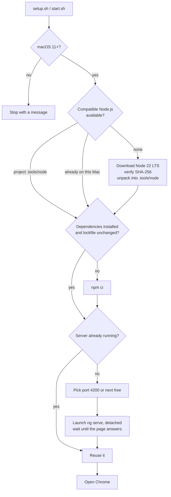

# Scripts & troubleshooting (macOS)

The helper scripts install what the app needs, run it in the background, open it in Chrome and stop it again.
They are written for a Mac that has **nothing** installed yet.

## 1. Quick reference

| Task | Terminal | Or double-click |
| --- | --- | --- |
| First-time setup + start | `bash setup.sh` | `Setup.command` |
| Start (and open Chrome) | `bash start.sh` | `Start.command` |
| Stop | `bash stop.sh` | `Stop.command` |
| Status (running? which port? log tail) | `bash status.sh` | `Status.command` |

Run the commands from the project folder (`cd` into it, or drag the folder onto the Terminal window after typing `cd `).

Environment switch: `NO_BROWSER=1 bash start.sh` starts without opening a browser.

## 2. Requirements

- macOS 11 (Big Sur) or newer, Apple Silicon or Intel.
- Internet connection (Node.js download, npm packages, and later the character data).
- About 1 GB free disk space.
- Google Chrome (optional: the default browser is used if Chrome is missing).

You do **not** need to install Node.js, Homebrew, git or Xcode tools.

## 3. What each script does



`setup.sh` and `start.sh` currently perform the same steps (setup is simply the name to use the first time;
`start.sh` also installs anything missing). Running either again is safe.

### Files the scripts create (all inside the project folder)

| Path | Contents | Safe to delete? |
| --- | --- | --- |
| `.tools/node/` | Private Node.js (only if the Mac had no compatible Node) | Yes, re-created by setup |
| `node_modules/` | npm dependencies, plus `.install-stamp` (hash of `package-lock.json`) | Yes, re-created by setup |
| `.run/dev-server.pid` | Process id of the running server | Yes |
| `.run/dev-server.port` | Port the server uses | Yes |
| `.run/dev-server.log` | Output of the dev server | Yes |
| `.angular/` | Angular build cache | Yes |

Nothing is written outside the folder, so deleting the folder removes everything.

### Design notes

| Topic | Behaviour |
| --- | --- |
| Node selection | Project's `.tools/node` first, then a compatible `node` (with `npm` next to it) already on the Mac, else download |
| Node download | Pinned version (22.23.3), architecture detected with `sysctl hw.optional.arm64`, SHA-256 verified, unpacked in a temp folder and moved into place only when complete |
| Compatibility range | Mirrors Angular CLI 20: `20.19+`, `22.12+` or `24+` |
| Dependencies | `npm ci --no-audit --no-fund` (exact versions from the lockfile); re-run only when the lockfile hash changes |
| Server process | `node node_modules/@angular/cli/bin/ng.js serve --host localhost --port N`, spawned detached (own session, stdin closed, output to `.run/dev-server.log`) so closing the Terminal does not stop it |
| Port | 4200, or the next free port up to 50 higher; the choice is stored in `.run/dev-server.port` |
| Readiness | Polls the URL for up to 180 s; if the process exits earlier, prints the log tail and fails |
| Stopping | `SIGTERM` to the server and its children, `SIGKILL` after 10 s |
| Safety | A process is only ever signalled if it is a node/`ng serve` process whose working directory is this project folder. Unrelated programs on the same port are never touched |
| Shell compatibility | Works with macOS's bash 3.2; uses only built-in macOS tools (`curl`, `tar`, `shasum`, `lsof`, `ps`, `pgrep`, `open`, `sysctl`) |

## 4. Typical sessions

First time (fresh Mac):

```text
$ bash setup.sh
==> No compatible Node.js found. Installing a private copy inside this project folder
==> Downloading Node.js 22.23.3 for arm64 (about 45 MB)...
==> Installing project dependencies (first time takes a few minutes)...
✔ Dependencies are installed
==> Starting the app on http://localhost:4200 (the first build takes up to a minute)...
✔ The app is running at http://localhost:4200
```

Later:

```text
$ bash start.sh      # opens Chrome
$ bash status.sh     # ✔ Running: http://localhost:4200 (process 12345)
$ bash stop.sh       # ✔ Stopped.
```

## 5. Sharing the project with someone

1. On your Mac run `POC/package-for-sharing.sh`. It creates `POC/share/character-explorer.zip`
   (a few hundred KB: no `node_modules`, `.angular`, `.tools`, `.run`, `dist`).
2. Send the zip. The recipient unzips it and follows `START-HERE.md`.
3. Re-run the packaging script after any code change, otherwise the zip is out of date.

## 6. Troubleshooting

| Symptom | Likely cause | What to do |
| --- | --- | --- |
| macOS says a `.command` file "cannot be opened" / "unidentified developer" | Gatekeeper quarantines downloaded files | Right-click the file, **Open**, then **Open** again; or System Settings > Privacy & Security > **Open Anyway**; or use the `bash ...sh` Terminal commands, which are not affected |
| macOS asks if Terminal may access Downloads/Documents | Privacy prompt | Click **Allow** |
| `Permission denied` when running a script | Executable bit lost (zip made elsewhere, file copied) | Run it with `bash setup.sh`, or `chmod +x *.sh *.command scripts/lib.sh` |
| "Could not download Node.js" | No internet, proxy or firewall | Check the connection; run the script again, it resumes |
| "failed its checksum test" | Corrupted or intercepted download | Run again; if it repeats, install Node 22 yourself from nodejs.org and re-run |
| "Installing dependencies failed" | Network problem during `npm ci` | Check the connection; run `bash setup.sh` again |
| "Port 4200 is used by another program, using port N" | Something else uses 4200 | Nothing; use the printed address (or free port 4200) |
| "The app did not start", with log lines | Build error or crash | Read `.run/dev-server.log` (printed on failure); fix, then `bash start.sh` |
| `status.sh` says "Not running" but you see the app | A server from another copy of the project, or started manually | Stop that one in its terminal; or `lsof -iTCP:4200 -sTCP:LISTEN` to find it |
| Chrome opens a blank/old page | Browser opened before the first build finished (rare) or an old tab | Reload the tab |
| The page loads but icons appear as words | Fonts/icons come from Google CDNs and are blocked or offline | Check internet access |
| Everything is broken after a Node upgrade | Stale `node_modules` built with another Node | Delete `node_modules` and `.tools`, run `bash setup.sh` |
| Start fails with "macOS 11 ... is required" | macOS older than Big Sur | Use a newer Mac or run `npm install && npm start` with a compatible Node |

### Starting completely fresh

```bash
bash stop.sh
rm -rf node_modules .tools .run .angular
bash setup.sh
```

### Uninstalling

```bash
bash stop.sh
# then delete the character-explorer folder (nothing else was installed on the Mac)
```

## 7. Not covered / known gaps

- The scripts target macOS only (no Windows or Linux equivalents).
- If Chrome is not installed, the default browser is used and no profile or window options are applied.
- The server is a development server (`ng serve`): fine for demos, not for production hosting. For a
  production build see the [Developer guide](developer-guide.md#7-building-for-production).
